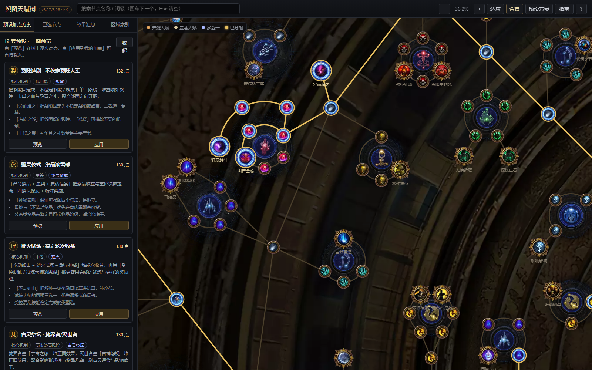
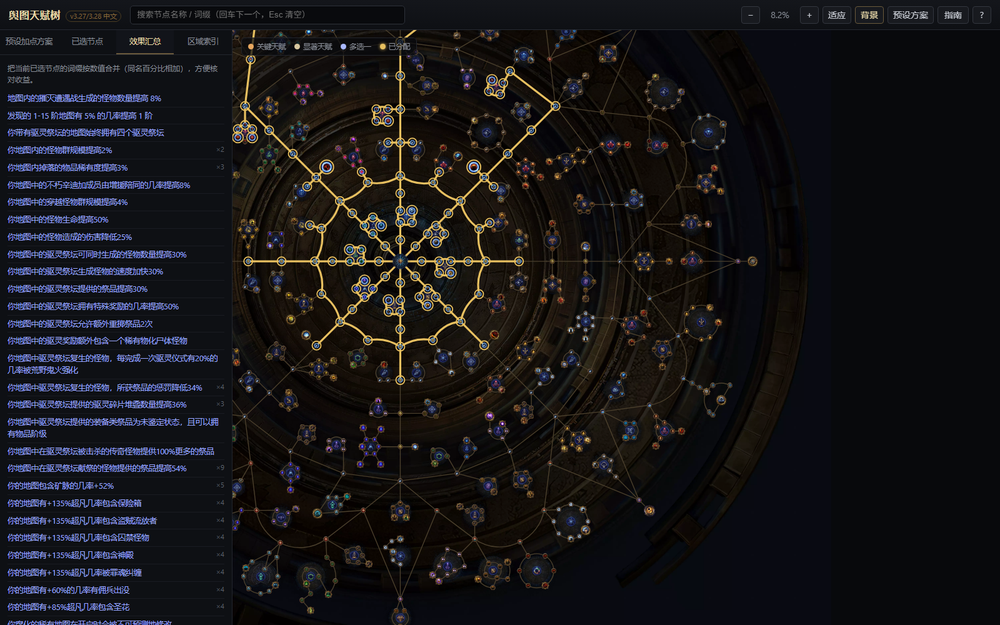

# 流放之路 1 · 舆图天赋树（中文交互版）

把 [hypostasis.faith/atlas](https://hypostasis.faith/atlas/data.html) 的流放之路 1 舆图天赋树完整中文化，并扩展成一个可离线运行的交互式加点规划器 + 中文专家攻略。

## 快速开始

需要 Node.js ≥ 20，无第三方依赖。

```bash
npm run build      # 数据 → 预设 → 指南 → 单文件 → dist/ 一键构建
npm run serve      # 本地预览 http://127.0.0.1:4173（同时打印局域网地址）
npm run audit      # 校验中英文数值一致性
```

构建产物在 `dist/`：

| 文件 | 说明 |
| --- | --- |
| `dist/index.html` | 单文件版站点（图片/数据/预设全内嵌，约 1.9 MB） |
| `dist/guide.html` | 中文完全指南（样式已内嵌） |
| `dist/README.txt` | 给朋友的说明 |
| `dist/.nojekyll` | 静态托管用，跳过 Jekyll |

`dist/`、`site/index.html`、`site/guide.html`、`*.zip` 都是**构建产物，不入库**（见 `.gitignore`）；仓库里只有源码与原始数据。

## 工程结构

```
site/                       站点源码
  index.template.html       页面骨架（引用 app.js / style.css / trees/*.js / assets）
  app.js                    渲染、加点、路径计算、预设预览、分享/导出
  style.css
  trees/data.zh.js          全量中文数据（构建生成，入库以便模板可直接跑）
  trees/presets.js          12 套预设（构建生成）
  assets/*.webp             5 张原版图集
docs/舆图天赋指南.md         指南源文件（Markdown → site/guide.html）
data/                       数据与中间结果（atlas.en.json / atlas.zh.json / presets.json …）
src_data/                   原始抓取快照（hypostasis data.js、poedb 页面）
tools/                      构建脚本（数据 / 预设 / 指南 / 单文件 / dist / 校验 / 截图测试）
.github/workflows/pages.yml GitHub Pages 自动部署
```

### 构建流水线

```
src_data/data.js
  └─ extract.mjs ─────────────▶ data/atlas.en.json
       └─ build_data.mjs（poedb 中文 + 人工词典 + 规则）
            └──────────────────▶ data/atlas.zh.json + site/trees/data.zh.js
              └─ build_presets.mjs（按区域 + 屏蔽逻辑）
                   └───────────▶ site/trees/presets.js
                     └─ build_guide.mjs ──▶ site/guide.html
                        └─ build_standalone.mjs（内嵌图集/数据/脚本）──▶ site/index.html
                           └─ build_dist.mjs ──▶ dist/
```

## 部署到 GitHub Pages（推荐）

仓库已配好 `.github/workflows/pages.yml`：push 到 `main` 后自动构建并发布 `dist/`。

1. 在 GitHub 新建仓库（**Public**；私有仓库需 Pro 才可用 Pages）。
2. 推送：
   ```bash
   git remote add origin https://github.com/<用户名>/<仓库名>.git
   git push -u origin main
   ```
3. 仓库 **Settings → Pages → Build and deployment → Source** 选 **GitHub Actions**（只需设置一次）。
4. 打开 **Actions**，等 `Deploy to GitHub Pages` 跑完，访问：
   `https://<用户名>.github.io/<仓库名>/`

之后每次 push 到 `main` 都会自动重建发布；也可以在 Actions 里手动 `Run workflow`。

> 如果 `deploy-pages` 报 “Pages is not enabled”，就是第 3 步没设置。

## 其他分享方式

- **发文件**：`npm run build` 后发 `dist/index.html`（或把 `dist` 压成 zip），对方双击即用。
- **Netlify Drop**：把 `dist` 拖到 <https://app.netlify.com/drop>。匿名站点 1 小时有效；**登录后再拖是永久站**。
- **Cloudflare Pages**：Workers & Pages → Create → Pages → Upload assets，拖 `dist`。
- **临时公网链接**：`npm run serve` 后另开终端 `npx cloudflared tunnel --url http://127.0.0.1:4173`。
- **传输注意**：微信/QQ 直接传 `.html` 可能被拦，优先发 zip 或直接发链接。

## 目录

- `site/`：站点源码与图集（模板 + app.js + style.css + trees + assets）
- `data/`：中文数据、预设、翻译词典与中间结果
- `docs/`：指南 Markdown 与截图
- `src_data/`：原始抓取快照（可复现构建）
- `tools/`：全部构建 / 校验 / 测试脚本
- `dist/`：构建产物（不入库，CI 生成并发布）

## 功能

- **全量中文**：1115 个节点名、609 条词缀全部中文（官方译名优先，其余人工校译）
- **100% 还原树形**：节点 / 连线 / 弧形链接 / 区域美术 / 背景全部保留
- **真实加点规则**：只能从起点连通加点，自动补最短路径，150 点上限，移除节点时正确处理「连带孤立节点」
- **多选一节点**：31 个多选节点弹菜单选择，可随时改选
- **效果汇总**：把已选节点的词缀按数值合并（同名百分比相加），带 ×N 计数
- **12 套预设**：裂隙 / 驱灵 / 摧灭 / 军团 / 圣花精华 / 保险箱命运卡 / 先祖秘藏 / 古灵祭坛 / 贤主 / 佣兵 / 迷雾深渊 / 开荒
  - 按**玩法区域**组织，不做「起点附近通用大点」灌水；每套标出玩法核心 / 过路点数与剩余自由点数
  - 线团向的 4 套写死「拉高自己 + 屏蔽同组竞争者」（右旋/褴褛、左旋/无丝），对应老版本的「屏蔽玩法」
  - 「预览」：绿色高亮整条路径，自动缩放到该区域
  - 「逐点回放」：从起点一个点亮
  - 「应用」：直接写入当前加点（自动补差集，不超 150 点）
- **分享**：加点会写进 URL hash（`#s=节点ID:选项,...`），复制链接即可分享
- **分享 / 导出**：一键复制带加点参数的链接，或复制「关键天赋 + 显著天赋 + 过路小点」的文本清单；本地 `file://` 下若浏览器拒绝剪贴板，会自动弹出「已全选」的手动复制面板
- **搜索 / 区域索引 / 撤销 / 定位**

## 截图

| 交互式天赋树（放大后显示中文节点名） | 预设一键预览 |
| --- | --- |
|  |  |

| 效果汇总（数值叠加） | 中文完全指南 |
| --- | --- |
|  |  |

## 快捷键

| 键 | 功能 |
| --- | --- |
| 拖动 / 滚轮 | 平移 / 缩放 |
| `+` `-` | 缩放 |
| `0` | 适应窗口 |
| `B` | 背景开关 |
| `/` 或 `Ctrl+F` | 聚焦搜索 |
| `Enter` / `Shift+Enter` | 下一个 / 上一个搜索结果 |
| `Ctrl+Z` | 撤销 |
| `←` `→` | 预设逐点回放 |
| `Esc` | 关闭菜单 / 提示 |

## 数据与版本

- 树结构与英文原文：hypostasis.faith 的舆图天赋页（页面数据版本，含线团 / 塑造之域 / 舆图异象 / 圣花 / 佣兵 / 贤主凿刀等机制）
- 中文名与词缀：优先取官方中文（poedb.tw/cn 收录的客户端文本），新机制与未收录节点为人工校译
- **版本提醒**：舆图天赋树几乎每个大版本都会重做，若你所在赛季更新，个别节点可能已被移除或改数值；请以游戏内天赋树为准

## 重新构建

```bash
npm run build      # 全量构建
npm run audit      # 中英数值一致性校验
npm run test       # 无头浏览器端到端测试（需先 npm run serve）
```

单独执行某一步：`npm run build:data` / `build:presets` / `build:guide` / `build:site` / `build:dist`。

## 致谢与声明

玩家自制工具，与 Grinding Gear Games 无关。游戏内容与美术资源版权归 GGG 所有；数据整理参考 hypostasis.faith 与流亡编年史。
